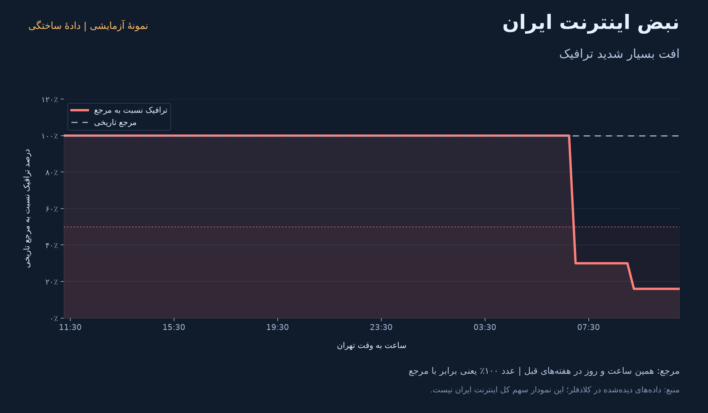

# نبض اینترنت ایران — ربات خصوصی تلگرام

ربات، دادهٔ ترافیک ایران در **Cloudflare Radar** را بررسی می‌کند و هنگام افت شدید، نمودار و توضیح فارسی ساده را به چت خصوصی شما می‌فرستد. گزارش‌های تازهٔ مرتبط در خوراک سایت **NetBlocks**، در صورت وجود، کنار تحلیل قرار می‌گیرند.

نصب روی سرور Ubuntu 22.04+ یا Debian 12+ با systemd، برای x86_64 و ARM64:

```sh
curl -fsSL https://raw.githubusercontent.com/yasinmalek82/monitor_internet_traffic/main/install.sh | sudo bash
```

اگر با کاربر `root` وارد سرور شده‌اید، انتهای دستور را `bash` بگذارید. نصب‌کننده توکن‌ها را به‌صورت مخفی می‌پرسد، اتصال را بررسی می‌کند و سرویس را راه می‌اندازد. برای پیدا کردن شناسهٔ چت، ابتدا `/start` را به ربات خودتان بفرستید و در مرحلهٔ شناسه، `find` بنویسید.

**کم‌مصرف:** یک پردازش پایش سبک، یک پردازش موقت برای نمودار، ذخیرهٔ آخرین نمودار در حافظه؛ بدون Docker، پورت ورودی، دیتابیس خارجی و سرویس AI. سرویس نصب‌شده سقف **۲۵۶ MiB حافظه** برای مجموع پردازش‌ها، سقف **۲۰٪ یک هستهٔ CPU** و اولویت پایین دارد. این سقف، مقدار مصرف دائمی نیست. [جزئیات نصب، مدیریت و مصرف منابع](docs/SERVER.fa.md)

**وضعیت اتصال:** تست آفلاین جای اتصال واقعی نیست. برای فعال شدن ربات روی سرور باید توکن‌های خودتان را وارد کنید. نصب روی هیچ سرور شخصی شما از این چت انجام نشده است.

## خروجی ربات

| دستور | کاربرد |
|---|---|
| `/start` یا `/help` | راهنما |
| `/status` | آخرین وضعیت و توضیح فارسی |
| `/chart` | نمودار ۲۴ ساعت اخیر همراه با توضیح |
| `/history` | پنج هشدار آخر که ارسالشان تأیید شده |
| `/sources` | روش استفاده و آخرین بررسی منابع مکمل |
| `/diagnostics` | زمان دریافت برنامه، زمان دادهٔ Radar و کیفیت پاسخ؛ برای عیب‌یابی |

هشدار افت شدید، تشدید افت و بهبود خودکار است. در حالت عادی پیام دوره‌ای ارسال نمی‌شود. ربات به چت دیگران و گروه‌ها پاسخ نمی‌دهد.

## نصب و دیدن نمونه، بدون توکن

به Python 3.12 یا جدیدتر و [uv](https://docs.astral.sh/uv/getting-started/installation/) نیاز است. در پوشهٔ پروژه:

```sh
uv sync --locked
uv run --locked python -m iran_monitor demo
```

نمودار `outputs/demo.png` و توضیح `outputs/demo-report.txt` **دادهٔ ساختگی با برچسب آزمایشی** دارند و وضعیت واقعی امروز نیستند. این دستور هیچ پیامی نمی‌فرستد.



## اتصال ربات خودتان

۱. در [BotFather](https://t.me/BotFather) یک ربات اختصاصی بسازید و توکنش را بگیرید. استفاده از ربات جداگانه از تداخل با برنامه‌ها و webhookهای قبلی جلوگیری می‌کند.

۲. از تنظیمات حساب Cloudflare یک **Custom API Token** با دسترسی **Account → Radar → Read** بسازید. برای این کار نیازی به کلید عمومی حساب یا تغییر تنظیمات دامنه نیست. [راهنمای رسمی Radar](https://developers.cloudflare.com/radar/get-started/first-request/)

۳. فایل تنظیمات را بسازید و با ویرایشگر پر کنید. توکن‌ها را در پیام چت یا دستور ترمینال ننویسید:

```sh
cp .env.example .env
chmod 600 .env
```

ابتدا `TELEGRAM_BOT_TOKEN` و `CLOUDFLARE_API_TOKEN` را وارد کنید. سپس در چت خصوصی ربات خودتان `/start` بفرستید. برای پیدا کردن شناسهٔ چت:

```sh
uv run --locked python -m iran_monitor chat-id
```

این دستور فقط شناسهٔ چت‌های خصوصیِ پیام‌دهنده به ربات خودتان را نشان می‌دهد و پیامی ارسال نمی‌کند. شناسهٔ عددی **چت خودتان** را در `TELEGRAM_CHAT_ID` قرار دهید. برای ربات دارای webhook، دستور متوقف می‌شود؛ webhook موجود را خودکار حذف نمی‌کند.

۴. اتصال و قالب پاسخ زنده را بررسی کنید:

```sh
uv run --locked python -m iran_monitor check
```

این بررسی پیامی نمی‌فرستد. معتبر بودن توکن ربات، دسترسی به چت شما، نبود webhook، دادهٔ واقعی Radar و دسترسی به منابع مکمل را بررسی می‌کند. نبود گزارش تازهٔ NetBlocks یا نامشخص بودن کیفیت داده با سالم بودن اینترنت یکی نیست.

۵. پایش و ارسال هشدار را اجرا کنید:

```sh
uv run --locked python -m iran_monitor run
```

در تلگرام `/status` و `/chart` را امتحان کنید. هنگام افت واقعیِ واجد شرایط، ربات خودکار پیام می‌فرستد. با `Ctrl+C` متوقف می‌شود.

برای استفاده از مسیر دیگر برای تنظیمات:

```sh
uv run --locked python -m iran_monitor --env /path/to/private.env run
```

## تشخیص به زبان ساده

- هر ۵ دقیقه منبع بررسی می‌شود؛ دادهٔ اصلی ۱۵ دقیقه‌ای است. آخرین بازهٔ کامل نیز ۱۵ دقیقه فرصت تکمیل دارد. بنابراین هشدار، لحظه‌ای نیست و تأخیر انتشار منبع به آن اضافه می‌شود.
- مرجع هر نقطه، میانهٔ همان ساعت و روز در سه هفتهٔ قبل است. حداقل دو هفته باید دادهٔ معتبر داشته باشند. تمام سری‌ها **در یک درخواست** و با مقیاس مشترک گرفته می‌شوند؛ خروجی‌های نرمال‌شدهٔ درخواست‌های جداگانه با هم تقسیم نمی‌شوند.
- **افت شدید:** ترافیک حداکثر ۵۰٪ مرجع در دو بازهٔ متوالی؛ **بسیار شدید:** حداکثر ۲۰٪ مرجع در دو بازهٔ متوالی.
- **بهبود:** پس از هشدار قبلی، ترافیک در دو بازهٔ متوالی به حداقل ۸۰٪ مرجع برسد. این پیام به معنی رفع تمام فیلترینگ یا محدودیت‌ها نیست.
- دادهٔ خالی، قدیمی، نامعتبر، کیفیت پایین یا فاصلهٔ بین بازه‌ها «نامشخص» است و قطعی یا بهبود حساب نمی‌شود. پس از سه بررسی نامشخص، یک پیام سلامت پایش ارسال می‌شود.
- اگر داده قدیمی اما از نظر کیفیت معتبر باشد، تحلیل آخرین بازه با برچسب «در آن زمان» و سن دقیق داده نشان داده می‌شود. این تحلیل تاریخی هشدار جدید یا پیام بهبودِ وضعیت فعلی ایجاد نمی‌کند. `/status` و `/chart` برای دادهٔ قدیمی دوباره دریافت را امتحان می‌کنند؛ تلاش دستی حداکثر یک بار در دقیقه است. اطلاعات خالی NetBlocks در گزارش عادی تکرار نمی‌شود.
- هشدارهای تکراری با SQLite مهار می‌شوند. بعد از ارسال موفق، وضعیت ذخیره می‌شود؛ هنگام شکست ارسال، بررسی بعدی دوباره تلاش می‌کند. تشدید از شدید به بسیار شدید یک بار اعلام می‌شود و تا بهبود، نوسان بین این دو وضعیت پیام تکراری تولید نمی‌کند.

در نمودار، خط‌چین ۱۰۰٪ یعنی ترافیک برابر مرجع تاریخی است. عدد ۲۰٪ یعنی ترافیک دیده‌شده توسط Cloudflare به یک‌پنجم مرجع رسیده؛ به معنی اتصال دقیقاً ۲۰٪ مردم ایران نیست.

## محدودیت منابع

**Radar:** این برنامه از NetFlows ایران و رخدادهای ثبت‌شدهٔ Radar استفاده می‌کند. این داده سهم دیده‌شده در شبکهٔ Cloudflare است، نه اندازه‌گیری همهٔ اینترنت کشور. افت ترافیک به‌تنهایی علت سیاسی/فنی یا اختلال یک اپراتور و شهر مشخص را ثابت نمی‌کند. اختلال محلی یا محدودیت یک سرویس ممکن است در نمودار کشوری مشخص نشود. اگر هفته‌های مرجع خودشان مختل بوده‌اند، مرجع هم پایین می‌آید؛ این روش مرجع قطعیِ «اینترنت بدون محدودیت» ندارد.

**NetBlocks:** API عمومیِ عددی پیوسته در این پروژه تأیید نشده است. فقط [خوراک عمومی سایت](https://netblocks.org/feed/) خوانده می‌شود؛ گزارش مرتبط با ایران باید تاریخ معتبر و انتشار در ۴۸ ساعت اخیر داشته باشد. نبود گزارش به معنی نبود اختلال نیست. در بررسی ۲۰۲۶/۱۰/۲۷، جدیدترین نوشته‌های این خوراک تاریخ ۲۰۲۳ داشتند. بنابراین این اتصال جای پایش حساب‌های اجتماعی یا دسترسی رسمی به دادهٔ زندهٔ NetBlocks را نمی‌گیرد. از گزارش قدیمی یا نمودار تصویریِ بدون داده، تأیید امروز استخراج نمی‌شود. منابع مکمل حداکثر هر ۳۰ دقیقه بررسی می‌شوند.

**تحلیل فارسی:** از محاسبات و قالب توضیحی تولید می‌شود؛ سرویس هوش مصنوعی خارجی، هزینهٔ API تحلیل یا ارسال اطلاعات به مدل دیگری ندارد.

## اجرای همیشگی و نگهداری

محل مشاهده و هشدار فقط تلگرام است؛ خود پردازش باید روی مک روشن یا سرور همیشه‌روشن اجرا بماند. با خواب/خاموش شدن مک، پایش هم متوقف می‌شود. برای استفادهٔ دائمی، اجرا روی سرور با یک مدیر سرویس مناسب‌تر است. اگر مسیر ارتباط خود برنامه با Telegram قطع شود، پیام تا دسترسی دوباره ارسال نمی‌شود.

- `data/state.sqlite3` وضعیت هشدار، آخرین داده و نشانگر پیام‌های تلگرام را نگه می‌دارد؛ با حذف آن این حافظه از بین می‌رود.
- فقط یک فرایند از یک `DATA_DIR` استفاده کند. برای همان توکن، نمونهٔ دوم روی میزبان دیگر نیز اجرا نکنید؛ Telegram تنها یک polling consumer را می‌پذیرد.
- داده و تنظیمات از Git کنار گذاشته شده‌اند. برای جابه‌جایی، برنامه را متوقف و کل پوشهٔ `data` و فایل `.env` را با دسترسی محدود منتقل کنید.
- توکن‌ها در گزارش خطا چاپ نمی‌شوند. ارسال تلگرام تضمین دقیقاً یک‌باره ندارد: اگر Telegram پیام را گرفته باشد اما تأییدش در شبکه گم شود، تلاش دوباره ممکن است همان پیام را تکرار کند.
- `POLL_SECONDS` حداقل ۶۰ و پیش‌فرض ۳۰۰ است. کاهش آن، دقت زمانی دادهٔ Radar را بیشتر نمی‌کند.
- در نصب سرور، کد در `/opt/iran-internet-monitor`، تنظیمات در `/etc/iran-internet-monitor/monitor.env` و داده‌ها در `/var/lib/iran-internet-monitor` است. به‌روزرسانی تنظیمات و داده‌ها را حفظ می‌کند. `sudo iran-monitor update` نسخهٔ تازه را آماده و سپس فقط همین سرویس را مجدداً راه‌اندازی می‌کند.
- کتابخانه‌های نمودار در فرایند دائمی بارگذاری نمی‌شوند؛ نمودار در فرایند موقت با حداکثر ۶۰ ثانیه زمان ساخته می‌شود. خطای تولید نمودار مانع ارسال هشدار متنی نمی‌شود.

## آزمون

```sh
uv run --locked python -m unittest discover -v
```

آزمون‌ها شامل منطق افت/بهبود، دادهٔ قدیمی و ناقص، مقیاس مشترک، تاریخ گزارش NetBlocks، حفظ وضعیت پس از راه‌اندازی مجدد، شکست ارسال، مجوز چت، محدودیت نرخ و تولید نمودار هستند. آزمون آفلاین جای تست واقعی توکن‌ها و تحویل نمودار در تلگرام را نمی‌گیرد.

## منابع فنی

- [NetFlows در Cloudflare Radar](https://developers.cloudflare.com/radar/investigate/netflows/)
- [مقایسهٔ صحیح سری‌های زمانی](https://developers.cloudflare.com/radar/get-started/making-comparisons/)
- [روش نرمال‌سازی](https://developers.cloudflare.com/radar/concepts/normalization/)
- [کیفیت داده](https://developers.cloudflare.com/radar/concepts/confidence-levels/)
- [رخدادهای اختلال](https://developers.cloudflare.com/radar/investigate/outages/)
- [Telegram Bot API](https://core.telegram.org/bots/api)
